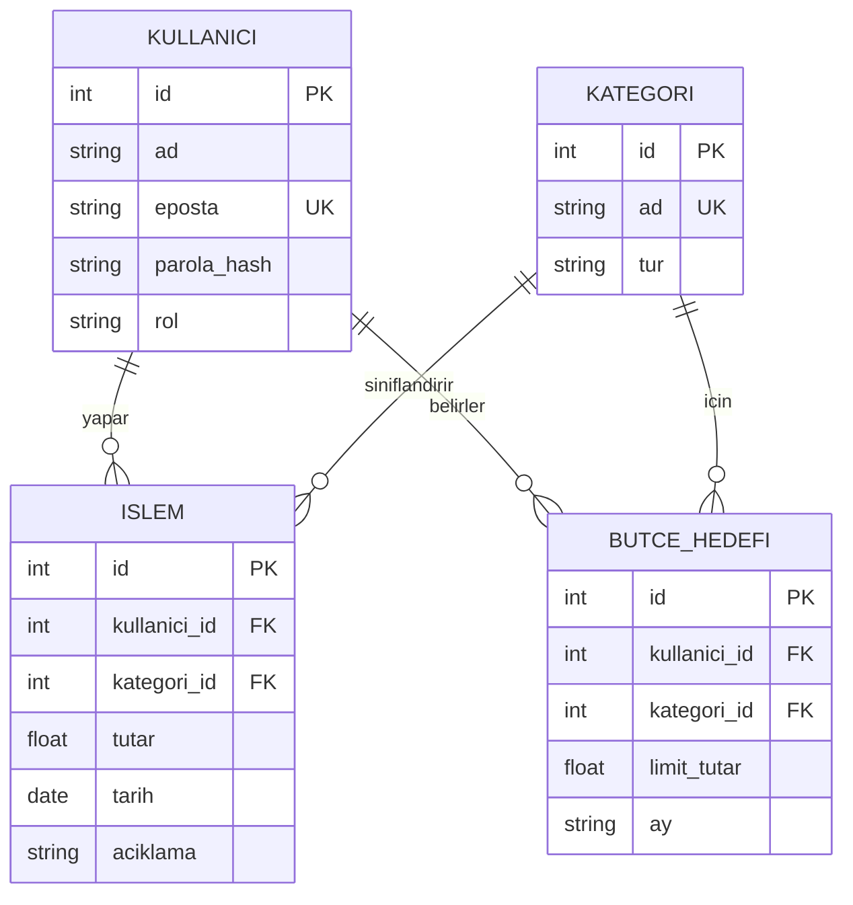
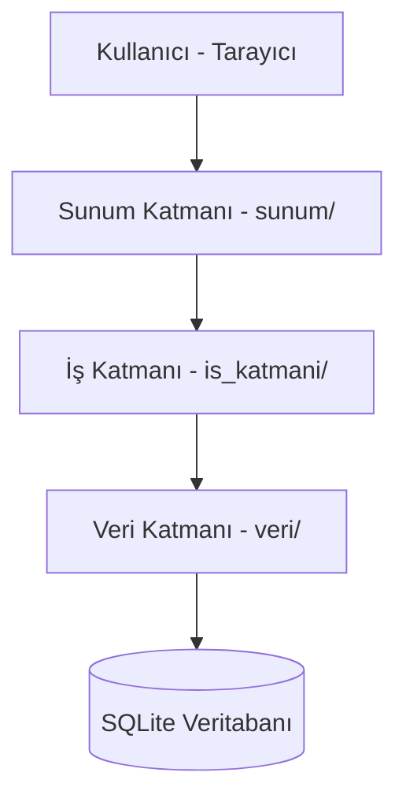

# Tasarım Belgeleri

## 1. ER Diyagramı

### İlişkiler
- **Kullanıcı – İşlem (1-N):** Bir kullanıcının çok işlemi olur, her işlem tek kullanıcıya aittir.
- **Kategori – İşlem (1-N):** Bir kategoride çok işlem olur, her işlemin tek kategorisi vardır.
- **Kullanıcı – Bütçe Hedefi (1-N):** Bir kullanıcı birden çok hedef koyabilir.
- **Kategori – Bütçe Hedefi (1-N):** Bir kategori için farklı aylarda/kullanıcılarda hedef olabilir.
- **Kullanıcı – Kategori (N-N):** Bütçe Hedefi tablosu üzerinden kurulur.

## 2. Mimari Şema (Katmanlı Mimari)

